<!-- Carlos Gabriel · perfil profissional -->

<a href="./README.md">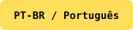</a>
<a href="./README.en.md"></a>

<picture>
  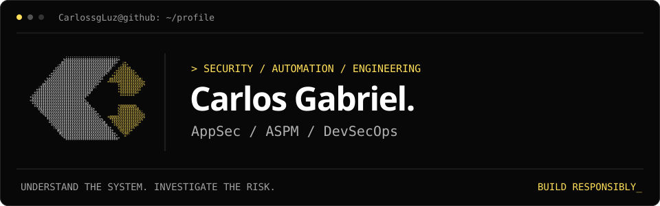
</picture>

**Analista de Desenvolvimento de Sistemas Jr. · Xmart Solutions**<br>
Segurança de aplicações, automação e engenharia de software.

[Portfólio](https://carlosg.com.br) · [LinkedIn](https://www.linkedin.com/in/dev-carlosgabriel/) · [Email](mailto:carlosgabriel.contato2007@gmail.com)

```json
{
  "cargo": "Analista de Desenvolvimento de Sistemas Jr.",
  "equipe": "Xmart Solutions",
  "foco": ["AppSec", "ASPM", "DevSecOps"],
  "metodo": ["investigar", "validar", "automatizar"],
  "base": ["software", "Linux", "observabilidade"]
}
```

## Atuação

Na **Xmart Solutions**, contribuo para o **XGuardian**, plataforma de AppSec e ASPM. Trabalho com relatórios e fluxos de análise de vulnerabilidades, métricas e controles de acesso, conectando necessidades de segurança ao desenvolvimento e à operação.

- **Vulnerabilidades:** contextualização de achados de SAST, SCA, DAST, Container Security e SBOM, com apoio de OWASP, NVD, CVE/CWE, CVSS e GitHub Advisory Database.
- **Controles de acesso:** participação no levantamento e desenvolvimento de RBAC, perfis, permissões e proteção de operações e APIs, em colaboração com a equipe.
- **Automação de releases:** desenvolvimento de QA para validar funcionalidades, permissões, integrações e pipelines por APIs, com execução controlada, evidências e rastreabilidade.
- **Software supply chain:** suporte técnico, testes, troubleshooting e documentação no ecossistema Sonatype, além de avaliação prática de recursos da Xygeni.
- **IA aplicada:** integração de modelos, agentes e ferramentas por APIs e MCP para investigação, QA e documentação, com atenção a contexto, credenciais e governança.

Minha base em **Python, TypeScript, CI/CD, Linux e observabilidade** sustenta esse trabalho. Desenvolvimento de interfaces e APIs faz parte da entrega, junto à investigação do comportamento e dos riscos do sistema.

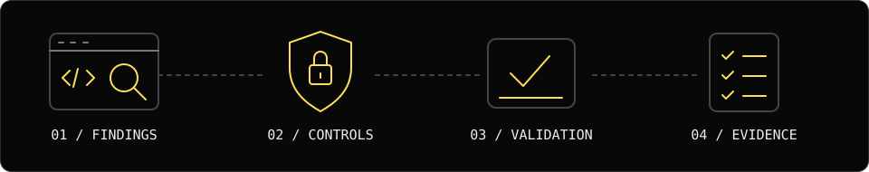

## Projetos em foco

### 01 / XGuardian

**AppSec · ASPM · experiência profissional**

Evolução de relatórios, métricas e fluxos de análise de achados de segurança; participação no desenvolvimento de RBAC e no redesign da plataforma interna. Também refiz o institucional de 2026, com UI/UX, responsividade e SEO.

[Institucional](https://www.xguardianplatform.io/) · [Entregas e registro visual](https://carlosg.com.br/#projects)

### 02 / QA de releases

**Automação · APIs · iniciativa interna em desenvolvimento**

Solução para verificações pré e pós-release do XGuardian, reduzindo a dependência de testes manuais. Validação de features, permissões, integrações e pipelines, com coleta de evidências e rastreabilidade das execuções.

[Visão geral no portfólio](https://carlosg.com.br/#projects)

### 03 / Open-Vaultin

**AI Agent Harness Governance · Python · MCP · JEV/TypeSafe · open source (Early V1)**

Projeto autoral e independente, **open source e em evolução contínua**, voltado à engenharia de harness para agentes de IA. O Vaultin implementa uma camada *local-first* de governança e conhecimento persistente: catálogo de agentes e skills, políticas de autorização, hooks do ciclo de vida do Codex, roteamento de tarefas com **modelo decisor JEV/TypeSafe** e fallback determinístico, ledger de execuções, evidências e sincronização Git/MCP. O roteamento é consultivo; as políticas são avaliadas separadamente. O cliente continua responsável pelo loop principal e a capacidade de enforcement depende da integração.

[Repositório e documentação](https://github.com/CarlossgLuz/Open-Vaultin) · [Arquitetura](https://github.com/CarlossgLuz/Open-Vaultin/blob/main/docs/architecture.md)

### 04 / APIsec

**AppSec · OWASP API Security Top 10 (2023) · FastAPI · projeto autoral**

Laboratório público para estudar e demonstrar **BOLA, BFLA e BOPLA**. Compara APIs vulneráveis e protegidas em cenários isolados com dados fictícios, gera evidências em JSON/Markdown e executa verificações com **Pytest, Ruff, Bandit, GitHub Actions e Docker**. Não executa scans contra terceiros e a topologia AWS documentada é apenas uma proposta, ainda não provisionada.

[Código, testes e documentação](https://github.com/CarlossgLuz/APIsec-LabTest)

<details>
<summary><strong>Outras entregas de engenharia</strong></summary>

- **[Clarium](https://github.com/CarlossgLuz/controle-fatura):** aplicativo de finanças pessoais com React Native, Expo, TypeScript e SQLite. [Landing page](https://github.com/CarlossgLuz/landingpage_clarium).
- **Toca dos Pés:** projeto freelancer de gestão de clínica, com agenda, financeiro, estoque, prontuários e permissões. Código privado do cliente.
- **[Portfólio](https://github.com/CarlossgLuz/portfolio_profissional):** site multilíngue com acessibilidade, responsividade, SEO técnico e identidade visual própria.

</details>

## Base técnica

<p>
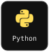
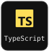
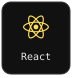
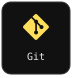
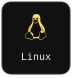
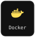
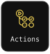
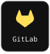
</p>

**Segurança de aplicações**<br>
ASPM · SAST / SCA / DAST · Container Security · SBOM · RBAC · EOL · Software Supply Chain Security

**Automação e integrações**<br>
Python · APIs REST · MCP · GitHub Actions · GitLab CI/CD · agentes e LLMs

**Engenharia e operação**<br>
TypeScript / JavaScript · React / Next.js · SQL · Git · Linux · Docker · Proxmox · AWS / Azure · Zabbix / Grafana / Prometheus

**Estudos e validações**<br>
Semgrep · OWASP ZAP · Gitleaks · Dependabot

## Formação e credenciais

- **ADS — UNICID:** em andamento, conclusão prevista para jun/2027.
- **Técnico em Desenvolvimento de Sistemas — SENAI:** concluído em 2026.
- **Técnico em Informática para Internet — Proz:** concluído em 2024.
- **Microsoft Azure Fundamentals — AZ-900** · **Scrum Foundation — SFPC**.
- **Inglês B2:** documentação e reuniões técnicas, com aperfeiçoamento contínuo.

[Credly](https://www.credly.com/users/carlos-gabriel.3078ca93) · [Certificados](https://drive.google.com/drive/folders/1tqgqmkPdQKNs1aRKDJx9HC5pRPwwvDYn?usp=sharing)

---

**Entender o sistema. Investigar o risco. Construir com responsabilidade.**
